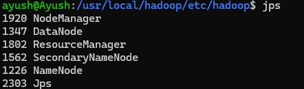
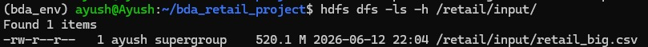
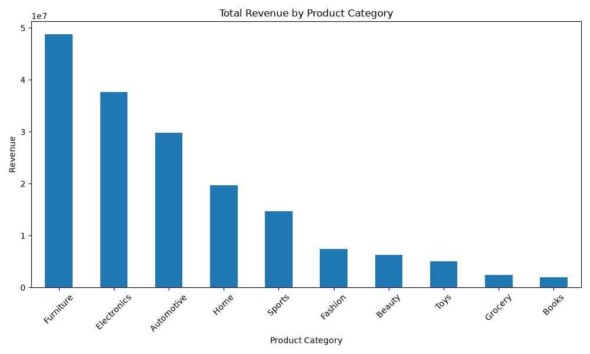
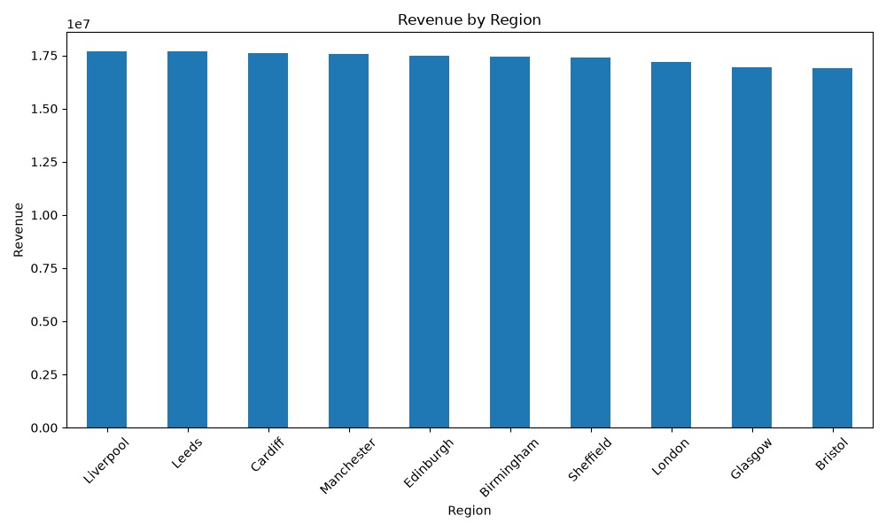
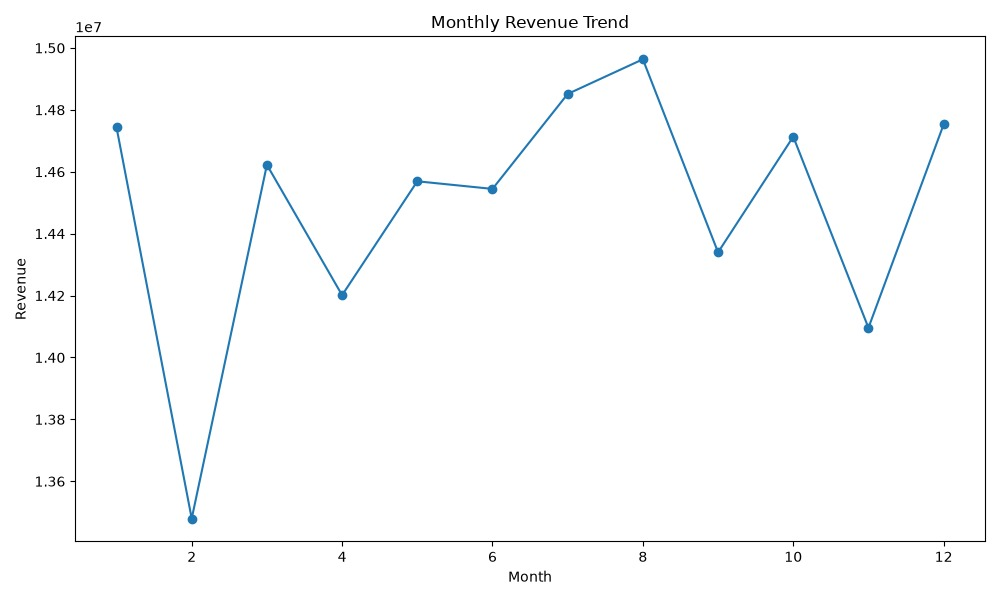
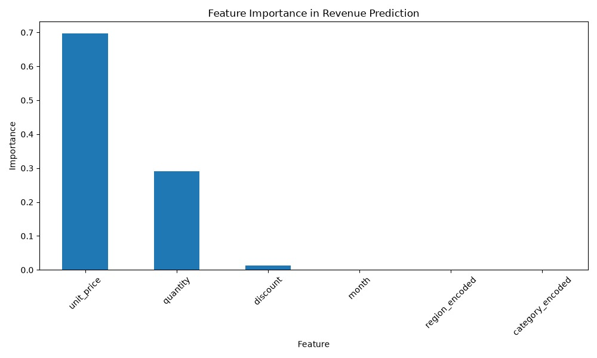

# Big Data Analytics for Retail Sales Forecasting

This project explores retail sales analytics using Hadoop HDFS, Apache Hive, and Python-based machine learning and visualization.

> **Environment note:** The project report describes a pseudo-distributed Hadoop setup on Ubuntu under WSL2, rather than a multi-node production cluster. The report describes the retail dataset as simulated.

## Objectives

- Store and inspect retail transaction data in HDFS.
- Analyze sales by product category, month, region, and customer using Hive.
- Explore a Random Forest regression approach for revenue prediction.
- Present analytical findings through visualizations.

## Technologies

- Apache Hadoop and HDFS
- Apache Hive
- YARN
- Python and data visualization / machine-learning libraries (as described in the report)

## Repository contents

- `docs/big_data_project_report.pdf` — project report.
- `screenshots/` — Hadoop/HDFS evidence and analytical charts.
- `hive/retail_analysis.hql` — a starter Hive script based on the analysis described in the report.
- `python/README.md` — status and next steps for the Python component.
- `data/README.md` — dataset notes.

## Screenshots

### Hadoop services

### Dataset stored in HDFS

### Revenue by product category

### Revenue by region

### Monthly revenue trend

### Feature importance

## Hive analysis

The starter Hive script includes example analyses for revenue by category, month, region, and customer. **Before running it, verify the CSV's exact column names, order, date format, and delimiter against your original dataset.** The script is a starter, not a verified copy of the original implementation.

## Python machine learning

The report describes a Random Forest regression model and evaluation using MAE, RMSE, and R². The original Python source files were not supplied with the materials used to prepare this repository, so the model code is not included yet. See `python/README.md`.

## Dataset

The HDFS screenshot shows `retail_big.csv` at approximately 520.1 MB. The dataset itself is not included in this ZIP. See `data/README.md` before deciding whether and how to share it publicly.

## Documentation

See [the full project report](docs/big_data_project_report.pdf).
